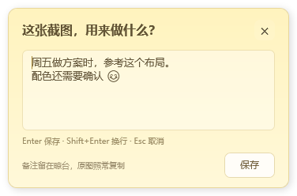
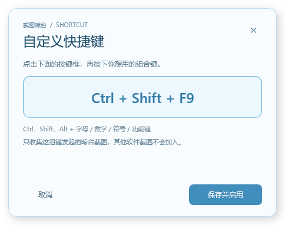

# 截图晾台 Snapline — Windows 版

0.5.4 新增截图用途备注：框选完成后，图片下方提供「＋ 添加备注」，点击打开小输入框，Enter 保存、Shift+Enter 换行、Esc 取消。备注显示为浅色纸条，放大预览里显示全文，长备注可在图片上滚轮查看。原图复制和拖出保持原有像素。

顶部展开仅在鼠标触碰实际绘制的中央蓝线并停留约 0.2 秒时触发；顶部其他位置和蓝线下方不再触发，离开线条立即重置等待。

0.5.3 新增开机启动：首次正常运行（包括旧版升级）自动为当前 Windows 用户启用，下次登录后收起运行。托盘「开机启动」可取消并记住选择。保留下述顶部蓝线展开修复。

0.5.2 修复 Windows 桌面与普通最大化窗口被误判为全屏的问题。当前触发范围使用 0.5.4 的实际蓝线位置。

0.5.1 新增自定义截图快捷键：右键托盘图标 → 截图快捷键 → 自定义，直接按下组合键后保存。支持 Ctrl、Shift、Alt 组合，保存时检查全局占用，重启后保留选择，操作提示同步显示。

0.5.0 新增悬挂便签，提供暖黄、薄荷绿、淡紫三种纸色，自动保存到本机，重启后恢复。默认 Ctrl+B 或当前自定义快捷键发起的晾台截图会自动加入。使用晾台自己的框选界面，结果直接挂上天空蓝晾衣绳；微信截图、Windows 截图、普通复制图片及其他软件保存的截图文件均不会自动加入。

独立 Windows 实现，交互灵感来自 [Tendedero](https://github.com/alejandrobujan/tendedero)。使用自行绘制的图标和新的名称。完全本地运行，不联网、不上传。

## 下载

[Windows 便携版 0.5.4](https://github.com/TE1233/snapline-windows/releases/download/v0.5.4/Snapline-Windows-0.5.4-portable.zip) · [源码包 0.5.4](https://github.com/TE1233/snapline-windows/releases/download/v0.5.4/Snapline-Windows-0.5.4-source.zip)

GitHub 下载不畅时，可尝试 [备用加速下载 1](https://ghfast.top/https://github.com/TE1233/snapline-windows/releases/download/v0.5.4/Snapline-Windows-0.5.4-portable.zip) · [备用加速下载 2](https://gh-proxy.com/https://github.com/TE1233/snapline-windows/releases/download/v0.5.4/Snapline-Windows-0.5.4-portable.zip)。

这两个入口无需注册，通过第三方服务转发 GitHub 原始发布文件。服务可用性可能变化；一个入口打不开时可尝试另一个。

便携包 SHA-256：`e4cb6eaab56efb181df69f25f748613927605d8c0b7d1af50d046f2aa8c3be8c`

完整解压便携版后，双击 Snapline.exe 即可运行。

## 使用

运行 dist/Snapline.exe。ZIP 请先完整解压，保留同目录的 Snapline.exe.config。已在本机 Windows 10（10.0.19045）验证，目标为 Windows 10/11 和 .NET Framework 4.8。程序约 160 KB，使用系统运行库，无需另装开发工具。

| 操作 | 效果 |
| --- | --- |
| Ctrl+B（默认）或已保存的自定义快捷键 | 拖动框选，松开鼠标后自动挂上晾台并复制图片 |
| 托盘「截图快捷键 → 自定义…」 | 按下组合键，保存并启用；重启后仍有效 |
| 框选时 Esc 或右键 | 取消，不添加图片，也不改动剪贴板 |
| 「操作提示」卡片里的截图按钮、托盘截图菜单 | 只截图并复制，不自动挂上晾台 |
| 微信截图、Win+Shift+S、普通复制图片 | 可以照常使用，不自动加入晾台 |
| 挂在图片右边的「操作提示」 | 悬停弹出说明 |
| 鼠标触碰顶部中央蓝线并停留约 0.2 秒 | 临时展开，离开约 0.7 秒收起 |
| 双击托盘图标或托盘「展开 / 收起」 | 临时展开，预留 3 秒供鼠标移入晾台 |
| 托盘「开机启动」 | 首次运行自动启用；可取消，之后保持关闭；登录时收起运行 |
| 托盘「固定显示」 | 勾选保持显示，取消恢复自动收起 |
| Ctrl+Alt+T | 展开并固定显示 / 收起 |
| 图片下方「＋ 添加备注」或已有纸条 | 点击添加或修改截图用途，Enter 保存、Esc 取消 |
| 悬停截图卡片 | 下方显示放大预览和完整备注，保持原比例，移开关闭 |
| 放大预览显示长备注时，在图片上滚轮 | 滚动备注全文 |
| 单击 / 双击图片 | 复制图片 / 打开查看 |
| 拖出图片 | 向接受文件的应用或文件夹拖放 PNG |
| 长按约 0.55 秒 | 在画图中编辑缓存副本，保存后更新缩略图 |
| 右键图片 | 复制 PNG 文件、打开、编辑、另存为、显示位置、移除 |
| 托盘「导入图片」 | 主动选择图片手动加入 |
| 「操作提示」卡片里的「＋ 便签」或托盘「新增便签」 | 创建便签并打开编辑窗口 |
| 双击便签 | 编辑文字、换纸色，停下输入后自动保存 |
| 编辑窗口「完成」、Ctrl+Enter 或 Esc | 保存并收起编辑窗口 |
| 悬停便签 | 展示全文，长内容可滚动查看；移开关闭 |
| 右键便签 | 编辑、复制文字、删除；删除前会确认 |

Ctrl+B 也常用于软件的加粗功能；本程序运行时优先响应截图。可在托盘「截图快捷键」关闭。预设的 Ctrl+PrtSc、Shift+PrtSc 仍仅截图并复制，不自动加入；Ctrl+B 和自定义组合会自动收集。自定义支持 Ctrl、Shift、Alt 加字母、数字、符号、功能键或 PrtSc，支持两键组合；不接受单独字符、Win 组合、F12 及晾台的展开快捷键。已注册的全局热键被占用时会提示，不接管；换键或保存失败时保留原设置。常用软件快捷键会提醒，但软件内部快捷键的冲突无法自动全面检测。

截图界面以开始框选时的桌面像素为底图；只保存选中的区域，遮罩、边框和说明不进入截图。最小区域 2×2 像素，支持反向拖动。取消后不会保留等待下一张剪贴板图片的状态。

## 显示和保存

- 截图、便签和提示卡用夹子挂在天空蓝弧线上，周围透出桌面。按创建时间从新到旧排列，数量较多时共同分页；编辑便签不会改变位置。
- 预览按屏幕空间缩放，最大约 760×460 逻辑像素；点击、拖动、切换页面、开始截图和收起晾台时关闭。
- 外部剪贴板和截图文件夹监听已移除，旧配置中的自动收集开关不会重新启用。自选文件夹历史配置保留，但不执行监听。
- 编辑现有缓存图片仍会更新卡片。普通新文件不会自动加入缓存。
- 相同像素的图片去重，最多保留 60 张。移除和清空仅删除应用副本，保留原文件。
- 每张截图可保存最多 2000 字符的用途备注，记录在 items.json，重启后恢复。空白保存只清除备注；备注不改变 PNG 像素、图片创建时间或排列位置，也不会单独成为便签。保存失败保留输入和旧记录，退出应用时也会尝试保存正在编辑的备注。
- 数据位于 %LOCALAPPDATA%/Snapline，便签独立保存在 notes.json。升级保留已有图片、便签与其他设置，错误详情写入 error.log。
- 便签没有 60 张截图的数量限制，清空截图不删除便签。刚新建的空白便签关闭后会丢弃；每张最多支持 20000 个字符。
- 保存失败时编辑窗口保留当前文字并提示重试；原便签文件无法读取时会保留文件，避免覆盖原记录。
- 首次正常运行自动注册当前用户的开机启动，无需管理员权限。右键托盘图标 →「开机启动」取消勾选后会记住关闭状态，重新打开仍保持关闭。首次升级到支持该功能的版本也会启用一次。
- 登录 Windows 后后台运行并保持收起，不抢焦点；重复的登录启动不会展开已有进程。手动再次运行同一 EXE 会临时展开或收起已有进程。
- 便携版请完整解压到准备长期保留的目录。移动程序后手动运行一次，会更新已启用的启动路径；删除程序前可先取消「开机启动」。使用当前用户 Run 项，仅修改 Snapline 自身条目，不修改 Windows 截图设置。Windows 可能延后启动，详见 [Microsoft 说明](https://learn.microsoft.com/en-us/windows/win32/setupapi/run-and-runonce-registry-keys)。
- 测试、演示及自定义数据目录运行不配置系统启动项；注册或保存失败会提示，保存失败时恢复原启动项与设置。
- 顶部悬停按实际可见蓝线的物理像素范围判断，蓝线为 68×2 逻辑像素；只在显示蓝线的屏幕上触发。已对 100%–300% 缩放、多屏负坐标、顶部任务栏和离开线条重置做逻辑验证；实际触碰蓝线及顶部其他位置在本机显示器验证。多屏及混合 DPI 的其他电脑需实际使用确认，本轮实际截图仅在当前显示器验证。第三方应用的粘贴、拖放取决于对方支持的格式。

## 编译和验证

用 PowerShell 运行 build.ps1，调用 Windows 自带 .NET Framework 编译器，输出至 dist。源码为 src/Snapline.cs、src/RegionCapture.cs、src/Memo.cs、src/Shortcut.cs、src/ShortcutEditor.cs、src/Hover.cs、src/Startup.cs、src/Remark.cs 和 src/Integration.cs。本地构建，未做数字签名。

tests/verify.ps1 验证便签持久化与保存失败处理、自定义快捷键录入、占用和保存失败回退、取消与重启恢复、截图存储、来源筛选、剪贴板输出格式、取消及过期结果、缓存编辑、自动收起、固定显示和快捷键占用。运行前退出本程序以释放全局快捷键。

tests/capture-selection.ps1 用 Windows PowerShell 的 STA 模式运行，验证真实 Ctrl+B、框选像素、Esc 与右键取消。它只保存自建示例窗口的截图。测试期间不要进行复制粘贴和鼠标操作；测试会短暂移动鼠标、写入示例剪贴板内容，结束时恢复原内容；若检测到用户之后复制了新内容则保留新内容。加 -CustomShortcut 可验证两键 Ctrl+F11、自定义触发键松开等待和实际框选。

tests/memo-ui.ps1 用 Windows PowerShell -STA 运行，在独立示例目录验证新建、纸色、完成保存及删除确认。测试短暂移动鼠标，结束时恢复位置；不写入剪贴板。

结果见 tests/store-results.txt、tests/memo-results.txt、tests/integration-results.txt、tests/hotkey-results.txt、tests/selection-results.txt 和 tests/ui-0.5.0-verification.md；自定义快捷键及 0.5.1 验证见 tests/shortcut-results.txt、tests/release-0.5.1-results.txt。0.5.2 顶部悬停验证见 tests/hover-results.txt 和 tests/release-0.5.2-results.txt。0.5.3 开机启动验证见 tests/startup-results.txt 和 tests/release-0.5.3-results.txt；已验证注册、关闭后重启恢复、移动路径、失败回退和收起启动，未为此重启整台电脑。0.5.4 备注及严格蓝线触发结果见 tests/remark-results.txt、tests/hover-results.txt 和 tests/release-0.5.4-results.txt。本轮旧剪贴板回归在读取已有数据时受不可读取格式阻止，没有清空或替换用户剪贴板；旧按键录入回归在未获得前台焦点时停止，没有注入按键。

## 来源与致谢

本项目的截图晾衣绳概念及单击复制、双击查看、长按编辑、拖拽分享等交互，参考了 [Alejandro Buján](https://github.com/alejandrobujan) 创作的 [Tendedero](https://github.com/alejandrobujan/tendedero)。原项目是使用 Swift、AppKit 和 SwiftUI 编写的 macOS 应用。

Snapline 是受该项目启发的独立 Windows 实现，使用 C#、WPF 和 .NET Framework 4.8。Windows 框选截图、Ctrl+B 专属收集、三色便签及本地持久化由本仓库实现。发布使用 Snapline / 截图晾台名称、自绘图标和自行生成的示例预览。

Tendedero 的源码采用 MIT 许可证，其名称、图标及 docs 图片有另外的使用限制，详情见 [原项目 LICENSE](https://github.com/alejandrobujan/tendedero/blob/main/LICENSE)。完整来源说明和固定版本参考见 [THIRD_PARTY_NOTICES.md](THIRD_PARTY_NOTICES.md)。

本仓库 Windows 实现采用 [MIT License](LICENSE.txt)。Ctrl+B 加粗用途见 [Microsoft Word 说明](https://support.microsoft.com/en-us/word/make-the-text-bold)。
